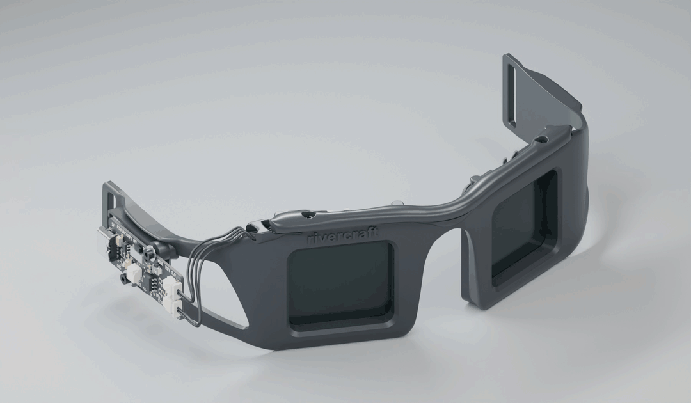
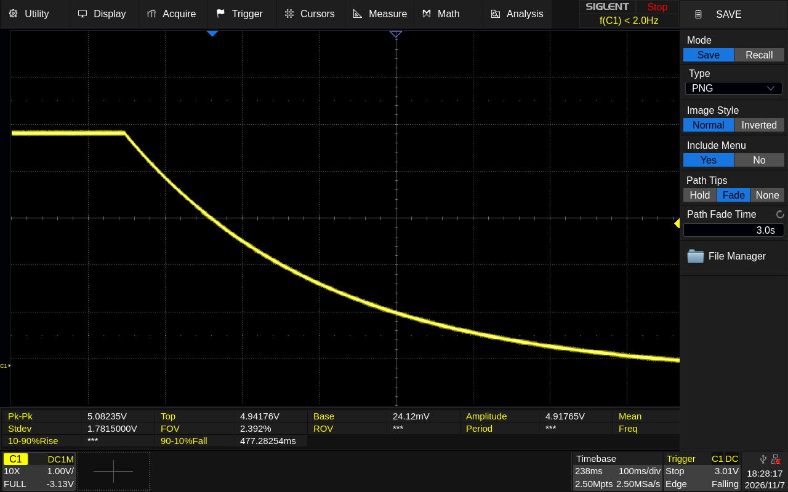

# Strobe Glasses

Have you been seeing too much? Disappointed by the lack of stuttering in your reality? Introducing Strobe Glasses.

Open-source strobe glasses for experimenting with visual reaction-time training.

One LCD light valve slides into each side of the frame and switches between
light and dark at an adjustable rate. The goal is a small, USB-C rechargeable
control board that fits into a resin-printed glasses frame.

The MK1 PCB uses an ATtiny402, with USB-C charging and an output for each eye.

[KiCad project](strobeGlassesMK1/) · [Electronic parts](hardware-library/BOM.md) · [Glasses STEP](mechanical/strobe-glasses-mk1.step) · [Print and assemble](mechanical/TOP_LOAD.md) · [Firmware](firmware/strobe_glasses/)

Electrical decay after disabling the 5 V PSU output (90–10%: 477 ms).
Shorting the valve leads clears it much faster.
