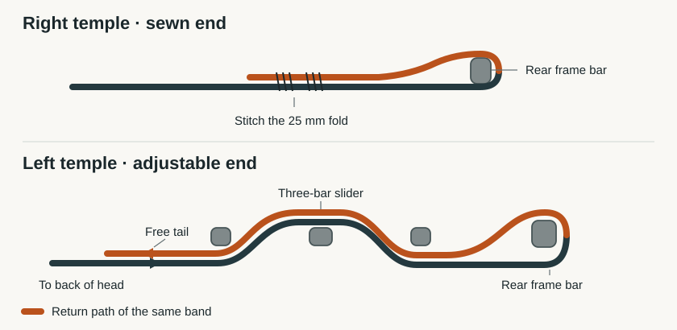

# MK1 Slim

The raised rivercraft lettering sits above the right lens. Print the frame
and the shared snap-in lens retainer. The right arm holds the battery underneath the PCB.

## Print and assemble

1. Start with `lens-test/lens_bay.stl` and `lens-test/lens_retainer.stl`.
   These are cuts from the finished parts. Try two actual wired panels, a
   spacer and the latch in this single bay. Use the strap coupon for the elastic. Print the PCB post coupon in the same
   resin and orientation as the frame, then wash and post-cure both alike.
2. For a Formlabs print, use a compatible Tough resin and tilt the frame with
   the battery lead exit downhill. Put supports on the inside of the arms,
   keeping the lens seats, brow, screw pilots and short wire passages clear.
   Flush the pilots and passages before post-curing. Check a loose wire
   contact in the shoulder guide coupon. For PETG, the frame STL stands on two
   lands under the lenses. Start with a 0.4 mm nozzle, 0.20 mm layers, four
   walls, a 4 mm brim and removable supports under the arms and over the bays.
3. Cut and route the wires as described below before soldering the valves.
   Match each pair’s optical orientations.
   At each shortened front terminal, solder the pigtail and one jumper side by
   side, then sleeve the joint. Loop the jumper back to the matching rear
   terminal and sleeve that joint too. The four sleeves per eye fit a
   2.4 × 1.5 mm envelope, with 3.5 mm of terminal behind each bend. Try
   the soldered stack in the single-bay coupon. [Valve drawing](https://cdn-shop.adafruit.com/product-files/3627/C10669_new_edition_GDC1260AA.pdf)
4. From the wearer side, fit the two wired panes and the 0.50 mm perimeter
   spacer into each bay, terminals up. The front pane sits on two lower stops
   which stagger the solder joints by 2.0 mm. Cut the spacers using
   `valve-spacer-template.svg`. Fit soft edge shims for the actual stack.
   Feed the flexible leads up through the open brow notches and press the
   shared retainer forward at the outer edges until both hooks seat.
5. In the cured `pcb-post-coupon.stl`, check the pilot with a #52 drill
   (1.61 mm). Turn it by hand if the hole printed undersize. The blind bore is
   4.6 mm deep. Try the 2 × 4 mm thread-forming screw with a 1 mm spacer
   and the washer. It should seat snugly and release with the post intact.
   Prepare both frame posts with the battery removed. Place the pack in the
   pocket with the wires forward and route them below the board edge to J2.
   Set the PCB on the posts. Fit a Ø5 mm washer over each edge notch and drive
   the screws by hand with a T6 driver until the washers just seat. Each screw
   forms its thread on first installation. [McMaster screw dimensions](https://www.mcmaster.com/products/screws/drive-size~ip6/) · [Formlabs guide to fastening in resin](https://formlabs.com/uk/blog/adding-screw-threads-3d-printed-parts/)

### Route the harness

The left pair crosses the fixed brow to **J3**. The right pair follows the
shorter path to **J4**. Each plug’s pin 1 drives the same terminal on both
panes. Pin 2 drives both opposite terminals. Mark one of the black conductors
at each end before soldering. The assembly STEP colors each eye for visibility.

For one pair of glasses, cut **two 305 mm double-ended crimp leads**. From
each lead, save one 165 mm crimped end for the left and one 90 mm crimped end
for the right. Use the middle offcuts for the four same-terminal jumpers.
Starting at the PCB, feed all four **bare solder ends** through the molded
passage in the right shoulder. Feed the two longer ends through the passage
at the nose bridge and on to the left eye. Lay the rest into the open
channels, leave a service bend at each plug, then trim and solder. The
shallow routes take 0.8 mm insulated wire. Each short jumper has about
6.7 mm of wire between sleeves plus the stripped ends. [JST SH drawing](https://www.jst.com/wp-content/uploads/2021/01/eSH.pdf)

Two short bridges in the frame retain the wires along the open brow channel.
The outer temple stays open for connector access.

To release the carrier, unplug J3 and J4 by their ears, pinch the two lands
inward about 0.9 mm and draw it straight back. To remove a wired valve
assembly completely, mark the pin order,
release the contacts from that plug housing and feed them back through
the guides one at a time.

The 22.6 × 12.1 mm pocket fits the protected SparkFun 25270 40 mAh pack up to
22 × 11.5 × 3.5 mm (length × width × thickness). The pocket is 5.0 mm
from floor to PCB. Its walls stop the pack sliding sideways, and the
screwed-down board closes the pocket with 1.5 mm of headroom. The board
bears on the posts. At the nominal centered position the nearest screw shank
clears the pouch by 2.70 mm. Removing the PCB frees the pack. The free lead
is 21.5 ± 3 mm from the pack to the back of the plug. The two CAD routes are 17.1 and 18.2 mm. The longer route
leaves about 0.3 mm at the shortest specified lead length. Dry-fit the pack
and close the board only when the plug seats without tension. J2 pin 1 is battery positive. [Battery drawing](https://cdn.sparkfun.com/assets/4/f/c/6/3/SPE-DTP301120SH-3.7V-40mah-En-1.0V.pdf)

## Make the light seal and strap

Print both foam templates at 100% and check their 20 mm rulers. Cut the
base pads from `foam-template.svg` and the face pads from
`foam-face-template.svg`, using 1/8″ black adhesive-backed neoprene for
both. The notched base pads go on the retainer with the notches up. Start
the unpowered fit check with both layers. The wider opening in the face
pad leaves room around the lids and bridges the base pad's wire notch.
Keep wires flush in their channels and trim the pad locally if needed.

With the strap lightly tensioned, blink normally and look up and down.
Check lash clearance and that the foam lands evenly around the brow and
cheeks. Use one layer if it clears your lashes and seals comfortably.
If you can see outside light near the cheeks or temples, cut local strips
with `foam-shim-template.svg`. Add one layer where needed and taper the
ends into the face pad. Keep each strip backed by the pad underneath.
Try the strips provisionally and check normal head movements before bonding.
The 126 mm temple measurement sets the fit target, and the straight inner
arms are 138 mm apart. The strap bars span about 143 mm on the outside.

Cut 650 mm of 3/4″ (19 mm) black flat elastic for the first pair.
The upright slots at the ends of the printed arms measure 20.8 × 4.2 mm.

1. **Right arm, PCB side.** Pass one end through the slot from the head side to
   the outside. Fold 25 mm back around the rear bar toward the band and sew the
   two layers together with two short rows of zigzag stitches. Keep the stitched
   overlap behind the arm so the USB port stays clear.
2. **Left arm, adjustable end.** Run the free end up through the first opening
   of the three-bar slider, over its center bar and down through the second.
   Pass the end through the left frame slot and fold it back around the rear bar.
   Retrace both slider openings in reverse, keeping the elastic flat. Leave a
   50 mm tail and slide the adjuster to fit.
3. Try the strap on with light tension. Give it a tug to check the slider grips
   before trimming the tail or cutting the other four bands. The strap coupon
   lets you check the thickness of the elastic before printing a full frame.



## Small parts for five pairs

| Qty for five pairs | Part |
| ---: | --- |
| 10 | [McMaster 96817A204, 2 × 4 mm thread-forming screw for plastic, T6/IP6, pack of 25](https://www.mcmaster.com/96817A204/) |
| 10 | [McMaster 93475A195, M2 stainless washer, Ø5 × 0.2–0.4 mm, pack of 100](https://www.mcmaster.com/93475A195/) |
| 10 | [JST SHR-02V-S-B two-pin housings for J3 and J4](https://www.digikey.com/en/products/detail/jst-sales-america-inc/SHR-02V-S-B/759866) |
| 10 | [JST ASSHSSH28K305, 305 mm, 28 AWG, socket at each end](https://www.digikey.com/en/products/detail/jst-sales-america-inc/ASSHSSH28K305/6009453) |
| 1 roll | [Airisoer 3/4″ black flat elastic, 12 yd](https://www.amazon.com/dp/B0CBYLZM5Q) |
| 5 | [Strapworks PLH-SLD-034-WDM-BLK, 3/4″ wide-mouth sliders](https://www.strapworks.com/34-inch-plastic-slide-wide-mouth-black) |
| 1 pack | [Storystore FSSA01, 1/8″ adhesive neoprene, five 12 × 8″ sheets](https://www.amazon.com/dp/B08P1XQMQH) |

With the 1.0 mm PCB and specified washers, the screws extend 2.6–2.8 mm
into the posts. The centered washers overlap the board notches and clear the
nearest solder-mask openings by at least 0.67 mm. The STEP shows the screw
core within the pilot. Check the thread hold in the cured post coupon.

For the PETG insert version, use two [McMaster 94459A767 M2 inserts](https://www.mcmaster.com/94459A767/)
and two [McMaster 92832A107 M2 × 4 machine screws](https://www.mcmaster.com/92832A107/)
per pair, with the same washers. Heat-set the inserts flush before fitting
the pack. Buy 3.25 m of elastic if buying by length.

## CAD and print checks

- On the wrapped frame, sections through the molded cable passages measured
  at least 1.23 mm of roof and 1.57 mm of floor at the sampled wire lanes.
  The narrowest sampled roof-to-floor gap was 1.94 mm. Test a loose contact
  in the printed shoulder coupon to measure bridge sag on your printer.

- The front and rear design datums are 7.25 mm apart along the lens normal.
  The retainer plate is 1.05 mm thick, with 1.25 mm at the snap beams.
  One foam layer brings local depth to 10.43 mm and two to 13.60 mm before
  compression.
- At 35% foam compression, the contact plane sits 3.46 mm behind the rear
  glass with one layer and 5.53 mm behind it with two. The wearer’s cornea
  and lashes sit at a different depth from that plane. Check actual fit
  with the glasses unpowered.
- The 34.4 × 31.2 mm front bevel tapers to the 32 × 28.3 mm optical bore.
  The snap channel opens inward at its entry. The 1.30 mm wide spring
  beam has 0.30 mm nominal lateral clearance in the straight guide.
- The maximum size panes have 0.30 mm of side clearance, with 0.25 mm
  available at the front seat and 0.35 mm at the rear for soft shims. Check
  those shims against the actual panel thickness before seating the retainer.
- The snap check moves both hooks through withdrawal with 0.90 mm inward
  travel. The cured coupon checks actual flex and print tolerance.
- Straight through, the 32 × 28.3 mm rounded apertures clear both foam pads
  and the retainer. The wearer view shows their alignment.
- On the unscaled NIOSH Small headform, the wrap reduced the projected
  rear glass-to-headform gap at eye height from about 21 to 16.5 mm at the
  aligned pose. The cheek and temple gaps call for local pad fitting.
  Check the real LCDs at 20° incidence and check comfort with the glasses
  unpowered. [NIOSH headforms](https://stacks.cdc.gov/view/cdc/223510)
- The strap slots leave 3.1 mm of material on each side along the band
  pull direction. A 19.05 mm wide elastic stack 3.6 mm thick passes with
  0.29 mm of minimum modeled clearance. The USB plug clears the modeled
  strap by 0.40 mm.
- The captive pack has 1.50 mm nominal clearance above it. Its lead exit
  opens down to the pocket floor so the uncapped part drains during printing.

## Rebuild the CAD

Open `mk1-bare.step` for the assembled glasses. The two pieces in `print/`
make the frame and the shared lens retainer.

Use CadQuery 2.8 with `build_slim.py`. The PCB STEP uses the origin
`115.8x137.625mm` in KiCad. The included reference STEP is from the populated
MK1 board. Run the command from the extracted download folder.

```sh
python source/build_slim.py --pcb-step reference/mk1-pcb.step --output build
```

Check battery insertion and retention, the screw pilots, lens loading, both hooks
and the wire passages with `python source/check_lens_fit.py build`. Its lens sweep adds
0.15 mm at each edge of the maximum panel envelope. The released-hook
sweep adds 0.30 mm at each side and above and below. These are modeled
print-error allowances. Try the single-eye coupon on your machine.

The default builds the resin frame with thread-forming screws. Use
`--insert-diameter 3.2` for PETG with heat-set inserts.
Pass `--foam-layers 1` to export the one-layer assembly.
Use `--wrap-degrees 0` for the flat comparison. For a repository checkout,
generate the populated board STEP from the project root with KiCad CLI.

```sh
mkdir -p mechanical/build/reference
kicad-cli pcb export step --force --user-origin 115.8x137.625mm \
  -o mechanical/build/reference/mk1-pcb.step strobeGlassesMK1/strobeGlassesMK1.kicad_pcb
python mechanical/build_slim.py
```
