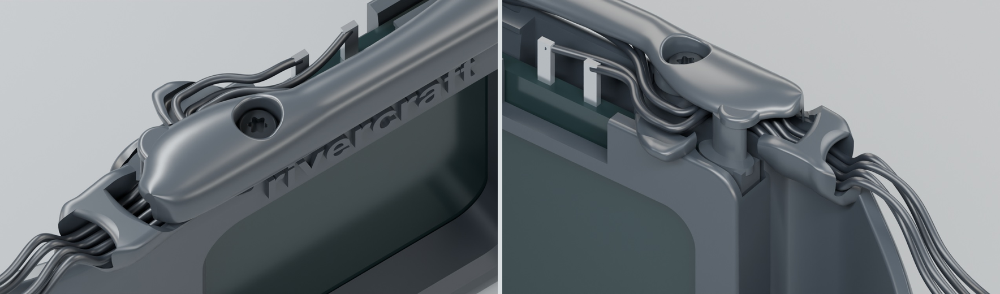

# MK1 top-loading frame

Open the [MK1 assembly STEP](strobe-glasses-mk1.step) to edit the frame and brow cover as separate solids. To print a pair, download one [frame STL](frame.stl) and one [brow cover STL](brow-cover.stl). The files use millimeters.

One Adafruit 3627 slides down into each rim. A narrow plate follows the top edge and catches the glass at its four corners. Two screws enter the rim from above, 81.6 mm apart. You can reuse the previous MK1 frame with that spacing. Print the revised frame for the rounded four-wire guide.

## Fit and assemble

1. Print one matched frame and cover. For a PETG trial, keep the glass slots
   vertical and keep support contacts out of the slots, pilots and wire guides.
   Clean up the print and try each loose pane before fitting the wires.
   For Tough 2000 Resin V2, flush the slots and pilots before curing.
2. Lower each pane straight down, metal pins up. The 2.20 mm slot leaves
   0.37 mm total front-to-back clearance for the measured 1.83 mm glass.
   The side lanes clear the fill tab and the cutout clears the pin roots.
   [Panel drawing](https://cdn-shop.adafruit.com/product-files/3627/C10669_new_edition_GDC1260AA.pdf)
3. Sleeve the solder joints and bend the flexible wires into the fixed
   trough. Keep the metal pins straight. Run the left pair across the bridge
   and both pairs around the right screw. Lay each pair’s pin 1 wire into
   the bend first, then its pin 2 wire above it. Feed the loose crimps through
   the shoulder guide before fitting the housings. J3 is left and J4 is right.
4. With the wires in their guides, lower the cover onto the rim. The long
   edge passes in front of both pin pairs. Seat it by hand, then drive the
   two McMaster 96817A204 screws (2 × 4 mm, T6/IP6) from above. Each screw
   engages about 2.5 mm of the printed rim. Remove both to lift the cover
   straight up. [Cap screws](https://www.mcmaster.com/96817A204/)
5. Invert the assembly over the bench to check that the panes stay captured.
   With power off, try the frame with the strap lightly tensioned to check
   forehead and lash clearance. The frame uses no face foam.

Both STLs sliced together in OrcaSlicer with generic PETG, a 0.4 mm nozzle, 0.20 mm layers, three walls and build-plate supports. Check screw fit and lens retention on the first print. The STEP includes the board, battery envelope, wiring and mounting hardware for reference.

Allow four 2 × 4 mm screws per pair, two for the cover and two for the PCB. [Battery, PCB and strap assembly](SLIM.md)
